<h4><i>"Engineering scalable backends. Designing resilient microservices. Built with Java, powered by curiosity."</i></h4>

> **STATUS:** Architecting resilient backends. Designing microservices. Mastering system design.

---

## 👨‍💻 About Me

I am **Manthan Sharma**, a Computer Science and Engineering student at **Ramdeobaba University** and an enthusiastic software engineer driven by backend engineering, distributed architectures, and modern web development.

My technical focus centers on **Java, Spring Boot, and Microservices**. I enjoy designing scalable backends, architecting reverse proxies and API gateways, writing clean RESTful APIs with stateless JWT security, and optimizing relational databases with Flyway and Hibernate. Beyond core backend systems, I actively build responsive full-stack applications with React and explore applied machine learning for biological signal classification.

### 🧠 Engineering Philosophy

- **Systems-First Thinking:** Understand how components interact under load before writing code.
- **Clean Architecture:** Loose coupling, high cohesion, and strict boundary enforcement across microservices.
- **Security by Design:** Stateless JWT tokens, role-based access control (RBAC), and validated API boundaries.

## ⚡ Current Direction

- 🏗️ **Backend & Microservices** — Architecting scalable microservices, reverse proxies, and stateless authentication pipelines with Java, Spring Boot, and Spring Security.
- 🌐 **Full-Stack Engineering** — Developing interactive, high-performance web applications using React, Vite, Material UI, and Tailwind CSS.
- ⚙️ **System Design & Performance** — Mastering low-level and high-level system design patterns, distributed caching, and algorithmic problem solving.
- 🔬 **Applied Machine Learning** — Analyzing physiological signal datasets (PSG) and deploying predictive models with Python, Scikit-learn, and Streamlit.

---

## 🚀 Featured Projects

<table>
  <tr>
    <td width="50%" valign="top">
      <a href="https://github.com/manthansharma6767/campus-exam-scheduler">
        <h3>Campus Exam Scheduler</h3>
      </a>
      
A comprehensive full-stack platform for managing university examination timetables, seating plans, and absentee paper workflows. Features stateless JWT authentication, student schedule search by enrollment number, timetable PDF import with OCR (Tesseract / PDFBox), Flyway migrations, and iCalendar (.ics) exports.

      

        
        
        
        
      

      

        
      

    </td>
    <td width="50%" valign="top">
      <a href="https://github.com/manthansharma6767/RentKart">
        <h3>RentLoop (RentKart)</h3>
      </a>
      
A peer-to-peer rental marketplace built specifically for the university community. Features an end-to-end booking lifecycle, real-time messaging via WebSockets (STOMP), item availability search, rating & review systems, and administrative management dashboards.

      

        
        
        
        
      

      

        
      

    </td>
  </tr>
  <tr>
    <td width="50%" valign="top">
      <a href="https://github.com/manthansharma6767/GateKeeper">
        <h3>GateKeeper - Smart API Gateway</h3>
      </a>
      
A distributed microservices API Gateway providing a unified client entry point, intelligent reverse-proxy request routing, and centralized monitoring. Comprises modular microservices including <code>smart-gateway-service</code>, <code>api-management-service</code>, and an integrated <code>analytics-service</code>.

      

        
        
        
        
      

      

        
      

    </td>
    <td width="50%" valign="top">
      <a href="https://github.com/manthansharma6767/Sleep-Disorder">
        <h3>Sleep Apnea Prediction System</h3>
      </a>
      
A machine learning healthcare project analyzing Polysomnography (PSG) signals to predict the Apnea-Hypopnea Index (AHI) and classify severity levels. Employs Random Forest Regressors, SVM classifiers, and signal processing techniques (MNE, SciPy), packaged into an interactive Streamlit web app.

      

        
        
        
        
      

      

        
      

    </td>
  </tr>
</table>

---

## 🛠️ Technology & Tools Arsenal

### Languages & Core

  
  
  
  
  
  
  

### Backend, Frameworks & Security

  
  
  
  
  
  
  

### Frontend & Web Development

  
  
  
  
  

### Machine Learning & Data Science

  
  
  
  
  

### Database, DevOps & Tools

  
  
  
  
  
  
  
  

---

## 📈 GitHub Stats & Activity

  <h3>👾 Pac-Man eating my contribution graph</h3>
  <picture>
    <source media="(prefers-color-scheme: dark)" srcset="./assets/pacman-contribution-graph-dark.svg">
    <source media="(prefers-color-scheme: light)" srcset="./assets/pacman-contribution-graph.svg">
    
  </picture>
   
  

  
  

  

  

---

## 📬 Let's Connect

  
  
  
  
  

  

> **Think in systems. Architect with discipline. Build software that scales.**

